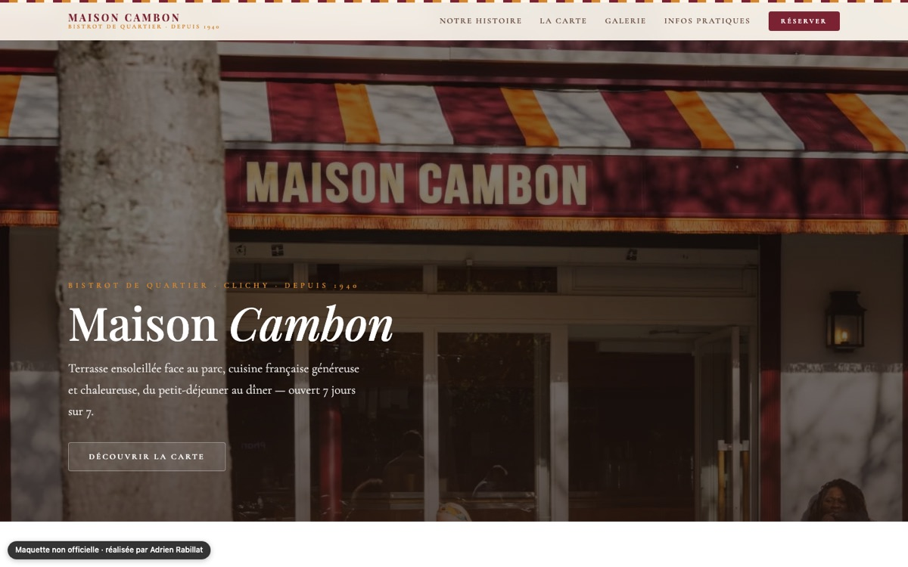

# Maquette — Bistrot Maison Cambon (Clichy)

Proposition de refonte du site d'un bistrot de quartier. **Maquette non officielle**, réalisée de ma propre initiative : le site n'est pas indexé par les moteurs de recherche.

**Démo** : https://maquette-bistrot-maison-cambon.vercel.app



## Contenu

- Page unique : histoire du lieu, carte, galerie photo, infos pratiques et réservation
- Identité visuelle inspirée de la devanture (rayures du store, typographie à empattements)
- Photos servies en WebP depuis `public/photos`

## Stack

React 18, Vite. Tout le site tient dans un seul composant (`maison-cambon.jsx`), sans dépendance d'interface.

## Lancer en local

```bash
npm install
npm run dev
```
